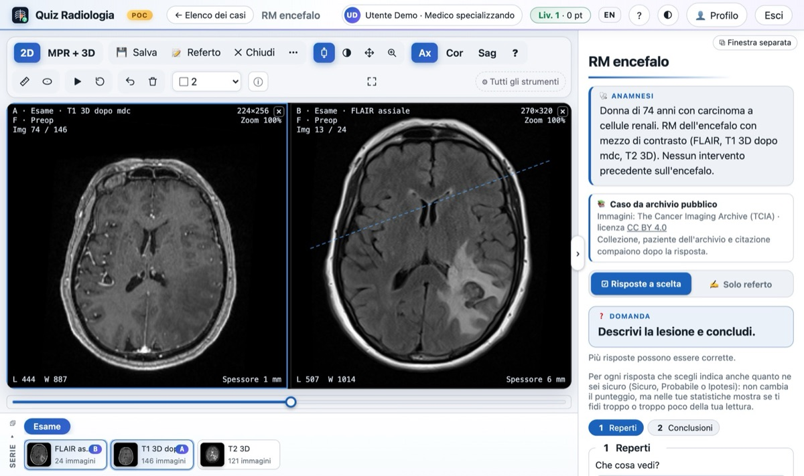
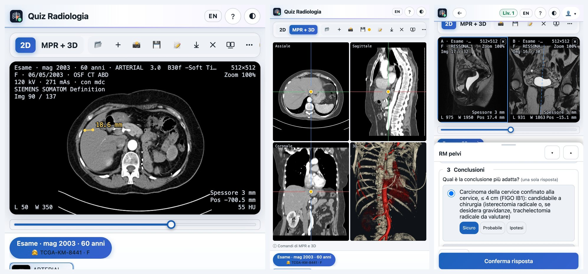

# Quiz Radiologia (radio-quiz.it)

[](LICENSE)
[](LICENSE-contenuti.txt)
[](https://reuse.software)
[](https://radio-quiz.it)

**[English version below ↓](#english)**

Piattaforma **open source a scopo educativo** per la formazione in radiologia: oltre 170 casi clinici reali e anonimi, un visualizzatore DICOM completo nel browser e domande a scelta multipla, con la discussione dopo la risposta.

**Prova subito, senza installare nulla:**
- **https://radio-quiz.it**: i casi, i percorsi tematici, le sfide;
- **https://radio-quiz.it/client/**: il visualizzatore DICOM gratuito, per aprire i propri esami sul proprio computer (le immagini non lasciano mai il dispositivo, funziona anche senza rete);
- **[video tutorial su YouTube](https://www.youtube.com/playlist?list=PLaHrPgfGWitU)**.

> Strumento didattico: **non è un dispositivo medico** e non va usato per la diagnosi o la refertazione clinica.





## Cosa si può fare

- **Casi clinici**: TC, RM, radiografie, ecografie, mammografie e vetrini di anatomia patologica da archivi pubblici; si risponde con le scelte (indicando quanto si è sicuri) oppure scrivendo un referto libero, poi si legge la discussione.
- **Visualizzatore DICOM**: scorrimento, finestre, misure di distanza, angolo e densità, ROI, MPR assiale/coronale/sagittale, volume 3D, confronto tra esami, serie affiancate, cine.
- **Vetrini digitali**: SVS, NDPI, MRXS, VSI, SCN, BIF e altri, aperti nel browser senza conversioni.
- **Percorsi tematici** (stadiazione oncologica, FIGO, BI-RADS, urgenze…) con test d'ingresso e attestato finale.
- **Sfide** tra colleghi sugli stessi casi.
- **Intelligenza artificiale nel browser**: ricerca dei noduli polmonari e bozza del referto, eseguite sul computer di chi le usa.
- **Italiano e inglese**, funziona su computer, tablet e telefono, installabile come app.

## Cosa contiene

| Cartella | Cosa c'è |
|---|---|
| `piattaforma-quiz/cloud/web/` | il sito: quiz, visualizzatore DICOM (2D, MPR e 3D, misure, confronto tra esami, vetrini digitali), versione scaricabile che funziona senza rete |
| `piattaforma-quiz/cloud/api/` | il server (AWS Lambda): accesso, risposte, statistiche, gestione dei casi |
| `piattaforma-quiz/cloud/lib/`, `bin/` | l'infrastruttura AWS (CDK): S3, CloudFront, Lambda, DynamoDB |
| `piattaforma-quiz/cloud/test/` | test di unità, del server e nel browser (Playwright), con un simulatore locale |
| `piattaforma-quiz/casi-free/` | i testi dei casi (domande, risposte, discussioni); le immagini non sono nel repository |
| `piattaforma-quiz/strumenti/`, `strumenti_claude/` | strumenti per preparare, anonimizzare e controllare i casi |
| `piattaforma-quiz/qualita/` | controlli di qualità e sicurezza (ESLint, copertura, Checkov, osv-scanner, semgrep) |

## Provarlo sul proprio computer

Servono Node.js 20 o più recente e, per le immagini, i casi scaricati dalle collezioni pubbliche indicate in ciascun `caso.json`.

```bash
cd piattaforma-quiz/cloud/test
npm install
PORTA=8080 CASI=../../casi-free node simulatore.mjs     # poi http://localhost:8080/?prova
bash esegui.sh                                          # tutti i test
```

La pubblicazione su AWS si fa con `piattaforma-quiz/cloud/pubblica.command`. Le chiavi e i codici stanno in un file `.segreti` che non è nel repository.

## Privacy

Le immagini dei casi sono anonime e provengono da archivi pubblici (The Cancer Imaging Archive e altri, con le licenze indicate nel sito alla pagina *Licenze e crediti*). Il visualizzatore scaricabile apre gli esami **solo sul computer di chi lo usa**: le immagini non vengono mai inviate in rete.

## Licenze

- **Codice:** European Union Public Licence v. 1.2 (`LICENSE`).
- **Contenuti didattici** (domande, risposte, discussioni, percorsi, guide): Creative Commons BY-SA 4.0 (`LICENSE-contenuti.txt`).
- **Librerie e modelli di terzi:** con le loro licenze (`piattaforma-quiz/cloud/web/lib/`, `modelli-ia/`).
- **Schermate in `docs/`:** immagini da collezioni di The Cancer Imaging Archive (CC BY 4.0).

I dettagli sono in `LICENZE.md`. Il repository segue lo standard [REUSE](https://reuse.software): la licenza e l'autore di ogni file sono in `REUSE.toml`, i testi completi nella cartella `LICENSES/` (controllo: `reuse lint`).

## Modelli di intelligenza artificiale

I file dei modelli non sono nel repository perché troppo grandi; si scaricano quando si usa la funzione che li richiede e girano nel browser, sul computer di chi li usa:
- **noduli polmonari:** MONAI `lung_nodule_ct_detection` (Apache-2.0, addestrato su LUNA16) convertito in ONNX con `strumenti_claude/noduli_onnx/`, eseguito con onnxruntime-web (MIT); su https://radio-quiz.it/modelli-ia/noduli-v2/, con le licenze accanto;
- **referto con l'IA nel browser:** Qwen3-4B (Apache-2.0) nella versione quantizzata di MLC, scaricato da WebLLM (Apache-2.0).

---

<a id="english"></a>
## English

**Quiz Radiologia** is a free, **open-source radiology teaching platform**: 170+ real, de-identified cases from public archives, a full DICOM viewer that runs in the browser, and multiple-choice questions followed by a case discussion. The interface and the cases are available in **English**.

**Try it, nothing to install:**
- **https://radio-quiz.it/?lang=en**: cases, themed learning paths with a certificate, challenges with colleagues;
- **https://radio-quiz.it/client/?lang=en**: the free DICOM viewer for your own studies. Images are opened **only on your computer** and never uploaded; it also works offline.

What's inside:
- **DICOM viewer:** scrolling, window/level presets, distance/angle/HU measurements, ROI, axial/coronal/sagittal MPR, 3D volume rendering, side-by-side series and prior-exam comparison, cine.
- **Whole-slide images** (SVS, NDPI, MRXS, VSI, SCN, BIF…) for radiology–pathology correlation, viewed directly in the browser.
- **Cases** in CT, MR, X-ray, ultrasound, mammography; answer with confidence levels (sure / probable / hypothesis) or write a free-text report.
- **Learning paths** (oncologic staging, FIGO, BI-RADS, emergencies…) with an entry test and a certificate.
- **In-browser AI:** lung nodule detection (MONAI, ONNX) and a draft report (Qwen3-4B via WebLLM), both running locally.
- Works on desktop, tablet and phone; installable as a PWA.

Run it locally: `cd piattaforma-quiz/cloud/test && npm install && PORTA=8080 CASI=../../casi-free node simulatore.mjs`, then open http://localhost:8080/?prova&lang=en. The code comments are in Italian.

> For education only: **not a medical device**, not for diagnosis or clinical reporting.

**Licences:** code under EUPL-1.2 (compatible with GPL, AGPL, MPL and others), teaching content under CC BY-SA 4.0, third-party libraries and models under their own licences. REUSE compliant.

---

© 2026 Ing. Salvatore Paolo Buemi · info@radio-quiz.it

Questo repository è una copia pubblica, aggiornata a ogni nuova versione, dello sviluppo che avviene altrove. / This repository is a public snapshot, updated at every release.
